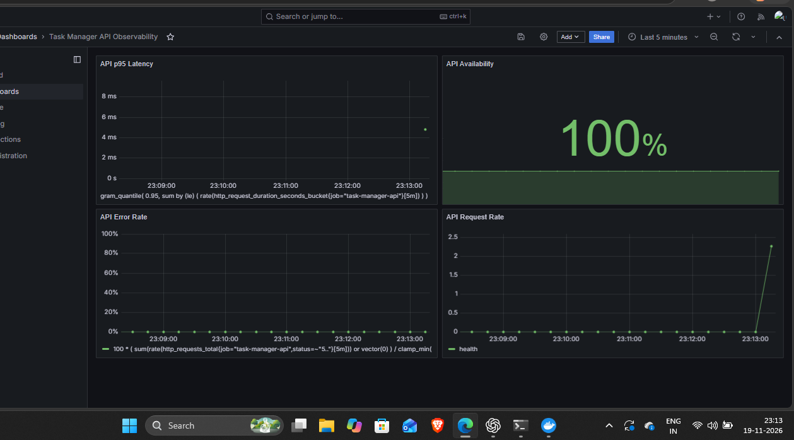

# 🚀 DevOps Task Manager API with CI/CD Pipeline


A Flask-based Task Manager REST API demonstrating Docker containerization, automated testing, CI pipelines, cloud deployment, and application monitoring using Prometheus and Grafana.

---

## 🌐 Live Demo

| Resource | URL |
|---|---|
| Application | https://cicd-flask-app-himd.onrender.com |
| Health Check | https://cicd-flask-app-himd.onrender.com/health |
| Metrics | https://cicd-flask-app-himd.onrender.com/metrics |

---

## 📌 Project Overview

This project demonstrates an end-to-end DevOps workflow by combining REST API development, Docker containerization, automated testing, continuous integration, cloud deployment, and observability.

### Features

- Task Management REST API
- CRUD Operations
- Health Monitoring
- System Statistics Endpoint
- Prometheus Metrics Integration
- HTTP Request Counters
- Request Latency Histogram
- Grafana Monitoring Dashboard
- Automated Testing with Pytest
- Test Coverage Enforcement
- Docker Containerization
- GitHub Actions CI Pipeline
- Docker Hub Image Publishing
- Cloud Deployment on Render

---

## ⚙️ Tech Stack

| Category | Technology |
|---|---|
| Language | Python 3.12 |
| Framework | Flask |
| Testing | Pytest |
| Coverage | Pytest-Cov |
| Monitoring | Prometheus |
| Visualization | Grafana |
| System Metrics | Psutil |
| Containerization | Docker |
| CI | GitHub Actions |
| Registry | Docker Hub |
| Deployment | Render |
| Version Control | Git & GitHub |

---

## 🔍 API Endpoints

| Method | Endpoint | Description |
|---|---|---|
| GET | `/` | Application Information |
| GET | `/health` | Health Check |
| GET | `/api/info` | Application Details |
| GET | `/api/stats` | System Statistics |
| GET | `/api/tasks` | List Tasks |
| POST | `/api/tasks` | Create Task |
| GET | `/api/tasks/{id}` | Get Task |
| PATCH | `/api/tasks/{id}` | Update Task |
| DELETE | `/api/tasks/{id}` | Delete Task |
| GET | `/metrics` | Prometheus Metrics |

---

## 🧪 Automated Testing

The application includes automated tests using Pytest.

- **Total Tests:** 18
- **Test Coverage:** 92.65%
- **Application Coverage:** 88%
- **CI Coverage Threshold:** 80%

### Run Tests

```bash
pytest -v
```

### Generate Coverage Report

```bash
pytest --cov=. --cov-report=term-missing
```

### Test Coverage Includes

- Health Endpoints
- API Information
- System Statistics
- Task Creation
- Task Retrieval
- Task Updates
- Task Deletion
- Error Handling
- Filtering Logic
- Metrics Endpoint

---

## 🐳 Docker Usage

### Build Docker Image

```bash
docker build -t cicd-flask-app .
```

### Run Container

```bash
docker run -p 5000:5000 cicd-flask-app
```

### Push Image

```bash
docker push chandrashekharhs/cicd-flask-app:v1
```

---

## 🔄 CI Pipeline

GitHub Actions automatically runs when code is pushed to the `main` branch.

### Pipeline Workflow

1. Checks out the repository.
2. Sets up Python 3.12.
3. Installs project dependencies.
4. Runs automated Pytest tests.
5. Generates test coverage reports.
6. Enforces a minimum 80% coverage threshold.

The pipeline fails if the test suite fails or coverage falls below the configured threshold.

---

## 📊 Monitoring and Observability

The application exposes Prometheus metrics through the `/metrics` endpoint.

### Implemented Metrics

- HTTP Request Counter
- HTTP Request Duration Histogram
- Request Status Codes
- Endpoint-Level Request Metrics

### Grafana Dashboard

A Grafana dashboard visualizes API performance using Prometheus as the data source.

The dashboard includes four panels:

1. **API Request Rate** – Tracks incoming requests by endpoint.
2. **API Error Rate** – Displays the percentage of HTTP 5xx responses.
3. **API p95 Latency** – Measures 95th-percentile request latency.
4. **API Availability (SLO)** – Displays API availability as a percentage.

### Dashboard Screenshot



### Monitoring Stack

- Prometheus – Metrics collection and querying.
- Grafana – Dashboard visualization.
- Docker Compose – Container orchestration.

---

## 🏗️ Deployment Architecture

```text
Developer
    |
    v
GitHub Repository
    |
    v
GitHub Actions
    |
    +---- Install Dependencies
    |
    +---- Run Automated Tests
    |
    +---- Validate Coverage
    |
    v
Docker Containerization
    |
    v
Cloud Deployment
    |
    v
Render
    |
    v
Live Flask API

Monitoring Architecture:

Flask API
    |
    v
Prometheus
    |
    v
Grafana Dashboard
```

---

## 🎯 DevOps Skills Demonstrated

- Linux Fundamentals
- Git & GitHub
- Python Development
- REST API Development
- Flask
- Automated Testing
- Docker Containerization
- GitHub Actions
- Continuous Integration
- Prometheus Monitoring
- Grafana Dashboards
- Metrics and Observability
- Cloud Deployment
- Troubleshooting
- DevOps Workflow Automation

---

## 📈 Future Improvements

- Kubernetes Deployment
- Helm Charts
- Terraform Infrastructure Automation
- GitOps with ArgoCD
- AWS EKS Deployment

---

## 👨‍💻 Author

### Chandrashekhar H S

Aspiring DevOps / Site Reliability Engineer

**GitHub:** https://github.com/Chandrashekhar-cloud

**Live Project:** https://cicd-flask-app-himd.onrender.com

---

⭐ If you found this project useful, consider giving it a star.
