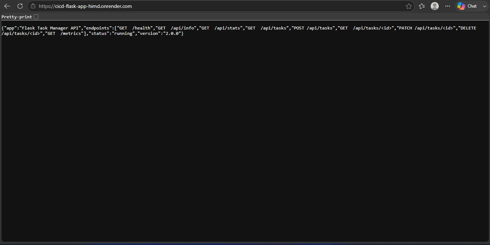
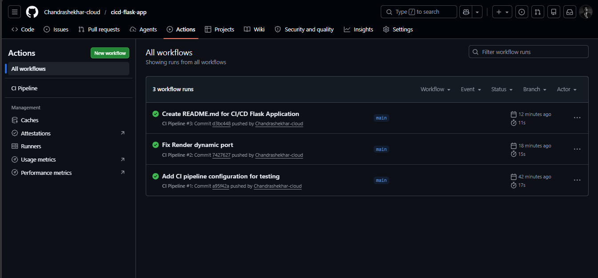

# 🚀 DevOps Task Manager API with CI/CD Pipeline


A Flask-based Task Manager REST API demonstrating Docker containerization, automated testing, CI/CD, Prometheus monitoring, Grafana observability, and cloud deployment.

---

## 🌐 Live Demo

| Resource | URL |
|---|---|
| Application | https://cicd-flask-app-himd.onrender.com |
| Health Check | https://cicd-flask-app-himd.onrender.com/health |
| Metrics | https://cicd-flask-app-himd.onrender.com/metrics |

---

## 📸 Screenshots

### Live Application



### GitHub Actions Pipeline



### Grafana Observability Dashboard


The Grafana dashboard provides visibility into:

- API Request Rate
- API Error Rate
- API p95 Latency
- API Availability

---

## 📌 Project Overview

This project demonstrates a practical DevOps workflow by developing, testing, containerizing, monitoring, and deploying a Flask-based REST API.

### Key Features

- Task Management REST API with CRUD operations
- Health check and application information endpoints
- System resource monitoring using Psutil
- Prometheus-compatible application metrics
- HTTP request counters with method, endpoint, and status labels
- HTTP request latency histogram
- Grafana observability dashboard
- Automated testing using Pytest
- 92.65% overall test coverage
- GitHub Actions CI pipeline
- Automated 80% minimum coverage enforcement
- Docker containerization
- Docker Hub image publishing
- Cloud deployment using Render

---

## ⚙️ Technology Stack

| Category | Technologies |
|---|---|
| Programming Language | Python |
| Framework | Flask |
| Testing | Pytest, pytest-cov |
| Monitoring | Prometheus, Grafana, Psutil |
| Containerization | Docker |
| CI/CD | GitHub Actions |
| Container Registry | Docker Hub |
| Deployment | Render |
| Version Control | Git, GitHub |
| Operating System | Linux |

---

## 🔍 API Endpoints

| Method | Endpoint | Description |
|---|---|---|
| GET | `/` | Application Information |
| GET | `/health` | Health Check |
| GET | `/api/info` | Application Details |
| GET | `/api/stats` | System Statistics |
| GET | `/api/tasks` | List Tasks |
| POST | `/api/tasks` | Create Task |
| GET | `/api/tasks/{id}` | Retrieve Task |
| PATCH | `/api/tasks/{id}` | Update Task |
| DELETE | `/api/tasks/{id}` | Delete Task |
| GET | `/metrics` | Prometheus Metrics |

---

## 🧪 Automated Testing & Coverage

The application includes **18 automated tests** covering:

- Health Endpoints
- API Information
- System Statistics
- Task Creation
- Task Retrieval
- Task Updates
- Task Deletion
- Error Handling
- Filtering Logic
- Metrics Endpoint
- HTTP Request Monitoring

### Test Coverage Results

| Metric | Result |
|---|---:|
| Total Tests | 18 |
| Tests Passed | 18 |
| Application Coverage | 88% |
| Overall Coverage | **92.65%** |
| Minimum CI Coverage | 80% |

### Run Tests

```bash
pytest -v
